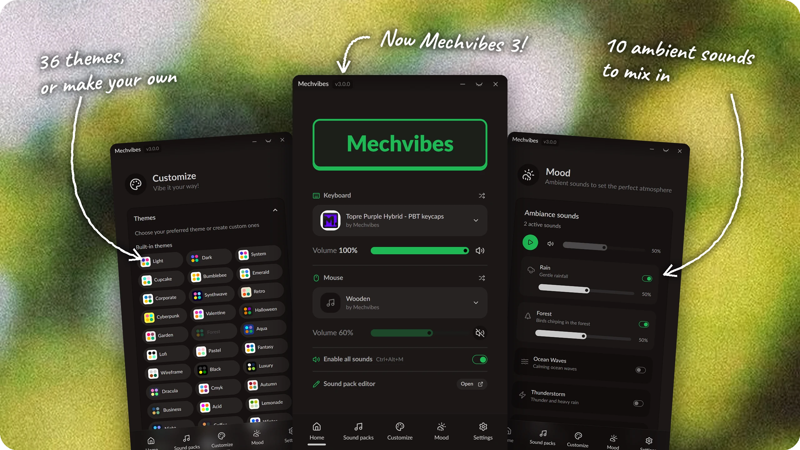

# Mechvibes

Play rich keyboard and mouse sounds with every keystroke and click, on Windows, macOS and Linux.

This is **Mechvibes 3**, the official Mechvibes app. It replaces Mechvibes 2 (the original Electron app) and MechvibesDX, and carries on from both with a faster audio engine, sound packs for your mouse as well as your keyboard, ambient sounds and themes.

## Download

| Platform | Installer | Notes |
|----------|-----------|-------|
| **Windows** | [`Mechvibes-*-Setup-x64.exe`](https://github.com/hainguyents13/mechvibes/releases/latest) | When a new version is out, click **Update now** in the app. The download is checked (SHA-256) before it installs. |
| **Linux (Debian/Ubuntu)** | [`mechvibes_*_amd64.deb`](https://github.com/hainguyents13/mechvibes/releases/latest) | `sudo dpkg -i`. On Wayland, also see [Linux](#linux) for the `input` group. |
| **Linux (any distro)** | [`mechvibes-*-x86_64.AppImage`](https://github.com/hainguyents13/mechvibes/releases/latest) | Portable, nothing to install: `chmod +x`, then run it. |
| **macOS** | [`mechvibes-*-macos-arm64.dmg`](https://github.com/hainguyents13/mechvibes/releases/latest) | Experimental, Apple Silicon only. Not notarized, so the first launch needs one extra step (see [macOS](#macos)). |

All links point to the [latest release](https://github.com/hainguyents13/mechvibes/releases/latest). Every release also ships a `SHA256SUMS.txt` covering all files.

## Coming from MechvibesDX or Mechvibes 2

- **Windows, from MechvibesDX**: nothing special. Click **Update now** when the app offers it, or run the new installer. Your settings, sound packs and "Start at login" carry over. Don't uninstall MechvibesDX first.
- **Windows, from Mechvibes 2**: run the new installer. It finds Mechvibes 2 and offers to remove it. Click **Yes**, or every key plays twice.
- **Linux**: install the new `.deb` as usual. It replaces MechvibesDX or Mechvibes 2 by itself.
- **macOS**: open the `.dmg` and drag Mechvibes to Applications (choose **Replace** if asked). macOS may ask you to allow Accessibility and Input Monitoring again. From 3.0.1, Mechvibes offers to move the old MechvibesDX app to the Trash for you; on 3.0.0, drag it there yourself.
- **Sound packs you added to Mechvibes 2**: from 3.0.1 they come over by themselves the first time Mechvibes starts, marked **New**. On 3.0.0, import them again as ZIP files.

## Features

- **Low-latency, polyphonic sound**: sounds are prepared once when a pack loads, not while you type, and play on their own audio thread. Up to 32 sounds overlap, and the oldest one fades out when you type fast, so there are no clicks or clipping.
- **Works in the background**: keyboard and mouse sounds play the same whether the Mechvibes window is in front or not.
- **Keyboard and mouse packs**: pick one pack for your keyboard and one for your mouse, each with its own volume. The app ships with 10 keyboard packs (Cherry MX, EG, Topre) and 4 mouse packs.
- **Mute in one keystroke**: `Ctrl+Alt+M` turns all sounds on or off. The tray icon shows when sounds are off.
- **Pick your speakers**: switch the output device (headphones, speakers, virtual devices) in Settings without restarting.
- **Mood**: 10 ambient sounds (rain, forest, ocean waves, coffee shop and more) to mix in, each with its own volume.
- **Themes and customization**: 36 built-in themes, your own themes, and a custom logo and background.
- **Verified updates**: on Windows, click **Update now** and Mechvibes downloads, checks and installs the new version. On macOS and Linux the app tells you when an update is out and links to the download page.
- **Your settings stay put**: they are saved in `%APPDATA%\Mechvibes` (Windows), `~/.local/share/mechvibes` (Linux) or `~/Library/Application Support/Mechvibes` (macOS), so they survive restarts, updates and reinstalls. Uninstalling on Windows keeps them unless you choose to delete them.
- **Logs for bug reports**: Settings > Debug shows a live log, with an **Export logs** button for attaching to an issue.

## Sound packs

A sound pack decides which sound plays for each key and mouse button.

### Add a sound pack

From the [sound pack library](https://mechvibes.com/sound-packs) on Windows and Linux, click **Install in Mechvibes** on a pack's page. Mechvibes opens, shows the pack's name, author and size, and installs it when you click **Install**. A pack you already have is updated the same way when the library has a newer version. On macOS, download the ZIP from the pack's page and add it as below.

To add a ZIP yourself:

1. Get the pack as a ZIP file, with `config.json` at the top of the ZIP.
2. Open **Sound packs**, choose the **Keyboard** or **Mouse** tab, click **Add**, then **Select file**.
3. Pick the pack on the **Home** page.

Already have a pack as a folder? In **Sound packs > Manage**, open the custom sound packs folder, copy the folder in, then click **Refresh**.

### Make a sound pack

The easiest way is the [sound pack editor](https://editor.mechvibes.com) (also linked from the Home page). By hand, a sound pack is a folder containing:
- **config.json** (required): the pack's name, author and key mappings
- **an audio file** (OGG, WAV, MP3 or FLAC): the sounds to play
- **icon.png** (optional): the pack's icon

**Minimal example:**
```
my-keyboard-pack/
├── config.json
└── typewriter-click.ogg
```

**config.json (V2 format):**
```json
{
  "id": "typewriter-minimal",
  "name": "Typewriter",
  "author": "You",
  "config_version": "2",
  "definition_method": "single",
  "audio_file": "typewriter-click.ogg",
  "definitions": {
    "KeyA": { "timing": [[0, 50]] },
    "KeyB": { "timing": [[50, 100]] }
  },
  "options": { "recommended_volume": 0.8, "random_pitch": false },
  "soundpack_type": "Keyboard"
}
```

Timing values are `[start_ms, end_ms]` within the audio file: every key plays its own slice of the same file. One segment plays when the key goes down; with two, the second plays when the key comes up. A pack can also give each key its own file with `"multi"`, and Mechvibes plays it as it is.

For every config.json field, key names, templates and troubleshooting, see [Sound pack config.json V2 format](docs/soundpack-config-v2.md).

### Classic Mechvibes packs

Packs made for the original Mechvibes (V1) are converted automatically when they load. Your old `config.json` is kept next to the new one as `config.json.v1.backup`, and your audio files are not changed.

## Platform notes

### Windows
- SmartScreen may warn on first run because the installer is not signed. Click **More info**, then **Run anyway**.
- "Start at login" works for your user account, with no admin rights needed.
- Only one copy of Mechvibes runs at a time. Opening it again brings the existing window back.

### Linux
- **Wayland and X11 both work.** On Wayland (the default on Ubuntu and Fedora), Mechvibes reads the keyboard and mouse directly, so your user must be in the `input` group:
  ```bash
  sudo usermod -a -G input $USER
  # Log out and log back in for the change to take effect
  ```
  On X11 this step is not needed, but it does no harm.
- On Wayland, touchpad taps and two-finger scrolling make no sound, and a mouse plugged in while the app runs is heard after you restart the app.
- "Start at login" is not available on Linux yet.
- Only one copy of Mechvibes runs at a time. Opening it again brings the existing window back.
- **AppImage**: most distros run it directly. If it does not start, run it with `--appimage-extract-and-run`. Settings are saved to `~/.local/share/mechvibes`. Run it once so the library's **Install in Mechvibes** links open it.

### macOS
- **Experimental**: Apple Silicon only, ad-hoc signed, not notarized, and not tested on real hardware by the maintainer.
- **First launch**: right-click the app and choose **Open**. On newer macOS versions, go to System Settings > Privacy & Security and click **Open Anyway**. If macOS says the app is damaged, run `xattr -cr /Applications/Mechvibes.app` in Terminal and open it again.
- **Permissions**: global key capture needs **both** of these in System Settings > Privacy & Security, enabled for `Mechvibes` (or for your terminal, if you launch the binary from there):
  - **Accessibility**: used while the Mechvibes window is focused.
  - **Input Monitoring**: used while the window is minimized or another app is focused. Without it the app runs normally but is silent unless its window has focus.
  - **Check them from the menu bar icon.** Click the Mechvibes icon: each permission shows "Granted" in green, or a red "Grant …" line that opens System Settings at the right page when clicked. It updates within about a second of a change. Granting **Accessibility** takes effect straight away. After granting **Input Monitoring**, quit and relaunch Mechvibes: macOS only lets an app capture keys globally if it had the permission when it started, so until you relaunch the menu can read "Granted" while sounds still stop when another app is in front.
- **After installing a new build**: the app is ad-hoc signed, so macOS ties its permissions to that exact binary. A rebuilt or reinstalled app keeps its toggles on but they stop working. Remove `Mechvibes` from both lists with the `-` button, add `/Applications/Mechvibes.app` back, and relaunch. Alternatively run `tccutil reset ListenEvent com.hainguyents13.mechvibesdx` and `tccutil reset Accessibility com.hainguyents13.mechvibesdx`, and macOS prompts again on next launch.
- **Start at login**: registers Mechvibes as a login item (System Settings > General > Login Items), which needs macOS 13 or later and the app installed in `/Applications`. If macOS asks, allow it there. "Start minimized" is read from your saved settings, so it applies whenever the app launches.

## Privacy and telemetry

Mechvibes sends one anonymous ping per launch to track rough usage.

**What is sent (once per launch):**
- OS name and version
- App version
- Your system language (locale)
- A random session ID (generated fresh each launch, never stored)

**What is never sent:**
- Keystrokes, mouse clicks, or any input data
- Sound pack names or usage
- File paths or personal data
- IP-derived identity or persistent identifiers

Telemetry is handled by [Aptabase](https://aptabase.com), an open-source, privacy-first service. **Opt out** anytime in Settings > Privacy > "Share anonymous usage stats".

Mechvibes also checks GitHub for a new version once a day. That check sends nothing about you.

Logs stay on your device until you click **Export logs** in Settings > Debug. The keys you press are never written to the log (they show as `***`), and your user name in file paths is replaced with `[username]` in the export.

## Building from source

### Prerequisites

**All platforms:**
- [Rust](https://rustup.rs/) 1.88.0 or later, declared as `rust-version` in `Cargo.toml`. The latest stable works.
- [Dioxus CLI](https://dioxuslabs.com/learn/0.7/getting_started) 0.7.10: `cargo install dioxus-cli --version 0.7.10`. If you use [mise](https://mise.jdx.dev/), `mise install` installs the pinned `dioxus-cli` from `.mise.toml`.

**Windows:**
- Visual Studio Build Tools (C++ support)
- [Inno Setup 6](https://jrsoftware.org/isinfo.php) (for building installers)

**Linux (Ubuntu/Debian):**
```bash
sudo apt-get update
sudo apt-get install -y \
    libasound2-dev \
    pkg-config \
    libwebkit2gtk-4.1-dev \
    libgtk-3-dev \
    libayatana-appindicator3-dev \
    librsvg2-dev \
    libevdev-dev \
    libxdo-dev \
    libxi-dev \
    libxtst-dev \
    libssl-dev
```

**Linux (Fedora/RHEL):**
```bash
sudo dnf install -y \
    alsa-lib-devel \
    pkg-config \
    webkit2gtk4.1-devel \
    gtk3-devel \
    libappindicator-gtk3-devel \
    librsvg2-devel \
    libevdev-devel \
    xdotool-devel \
    libXi-devel \
    libXtst-devel \
    openssl-devel
```

**macOS:**
```bash
xcode-select --install
```

### Build

**Development (all platforms):**
```bash
git clone https://github.com/hainguyents13/mechvibes.git
cd mechvibes
dx serve
```

**Run the release binary directly (macOS/Linux):**

The app looks for `soundpacks/` next to the executable. `cargo build` copies the bundled packs to `target/release/soundpacks/` for you (see `build.rs`), so the binary runs as is:
```bash
cargo build --release
./target/release/mechvibes
```
To capture a log for a bug report, run it as `RUST_BACKTRACE=1 MECHVIBES_TRACE=1 ./target/release/mechvibes 2>&1 | tee /tmp/mv.log`.

On macOS the permissions apply to the app that launched it. When run from a terminal, grant that terminal app **Accessibility** and **Input Monitoring** in System Settings > Privacy & Security, then restart the terminal.

**Release (Windows):**
```bash
.\scripts\build-windows-installer.ps1   # builds first; add -SkipBuild to reuse target\release
# Output: dist/Mechvibes-3.0.0-Setup-x64.exe
```

**Release (Linux, AppImage and DEB):**
```bash
cargo install cargo-deb                   # once; or pass --no-deb to skip the .deb
./scripts/build-linux-appimage.sh 3.0.0   # builds first; add --skip-build to reuse target/release
chmod +x dist/mechvibes-3.0.0-x86_64.AppImage
sudo dpkg -i dist/mechvibes_3.0.0_amd64.deb
# On Wayland: run 'sudo usermod -a -G input $USER' and log back in before first use
```

**Release (macOS):**
```bash
./scripts/build-macos-app.sh 3.0.0   # builds first; add --skip-build to reuse target/release
# Output: dist/mechvibes-3.0.0-macos-arm64.dmg
```

To run the same compile-and-test gate that CI runs (it also checks that Rust is at least the `rust-version` in `Cargo.toml`): `./scripts/ci-check.sh --release`. CI builds and packages every pull request and every push to `main` this way; when a `v*` tag points at a commit it built, the same run drafts the release from those packages.

For architecture details, see [docs/system-architecture.md](docs/system-architecture.md). For release procedures and deployment, see [docs/deployment-guide.md](docs/deployment-guide.md).

## Troubleshooting

**No sound playing?**
- Check that **Enable all sounds** is on (on the Home page, or press `Ctrl+Alt+M`). The setting is saved, so it stays off across restarts.
- Check that a sound pack is selected on the Home page, and that its volume is not at zero.
- Check your system volume and the output device in Settings.

**macOS: sounds only play while the app window is focused?**
- Click the Mechvibes icon in the menu bar: a red "Grant Input Monitoring…" line means it is missing.
- Input Monitoring is missing or stale. See the macOS permissions notes above: remove and re-add `Mechvibes` under both Accessibility and Input Monitoring, then relaunch. A relaunch is always needed after granting Input Monitoring, even when it was simply missing.

**`Ctrl+Alt+M` does nothing?**
- The shortcut works whenever Mechvibes can hear your keyboard. If keys make sound but the shortcut does not, export the logs from Settings > Debug and [open an issue](https://github.com/hainguyents13/mechvibes/issues).

**Linux: no keyboard input detected?**
- On Wayland, check that your user is in the `input` group: `groups $USER` should list `input`.
- Log out and back in after adding the group.
- Check device permissions: `ls -la /dev/input/event*` (should show `crw-rw---- root input`).

**Sound pack won't import?**
- It has to be a ZIP file with `config.json` at the top of the ZIP.
- Check that `config.json` is valid JSON (use a JSON validator).
- Check that `definitions` (or `defs`) contains valid key mappings.
- Check that the audio file (OGG, WAV, MP3 or FLAC) is in the ZIP.

**Settings reset after restart?**
- Settings are stored in `%APPDATA%\Mechvibes` (Windows), `~/.local/share/mechvibes` (Linux) or `~/Library/Application Support/Mechvibes` (macOS). Check that these folders exist and are writable.

## Credits

Mechvibes is built in Rust with [Dioxus](https://dioxuslabs.com/) (0.7). Audio uses [rodio](https://github.com/RustAudio/rodio) and [Symphonia](https://github.com/pdeljanov/Symphonia). Input is captured with Windows Raw Input, [evdev](https://github.com/emberian/evdev) and [rdev](https://github.com/Narsil/rdev).

Mechvibes 3 replaces the original Electron app, Mechvibes 2, which now lives in the archived [mechvibes-electron](https://github.com/hainguyents13/mechvibes-electron) repository.

## License

MIT License. See [LICENSE](LICENSE) for details.
